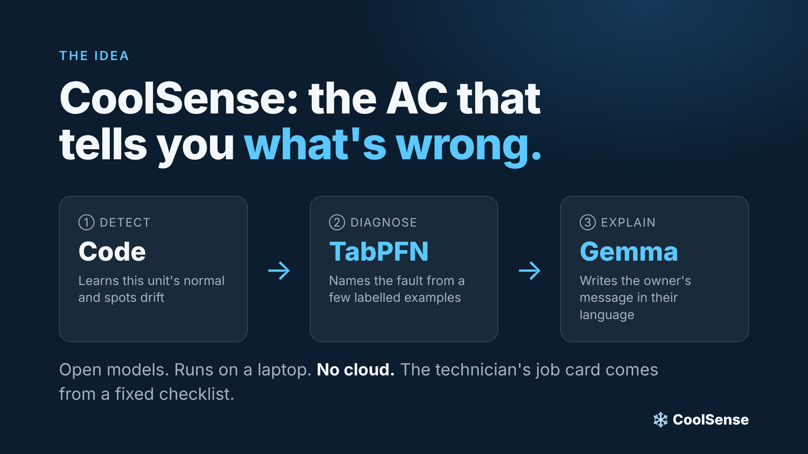
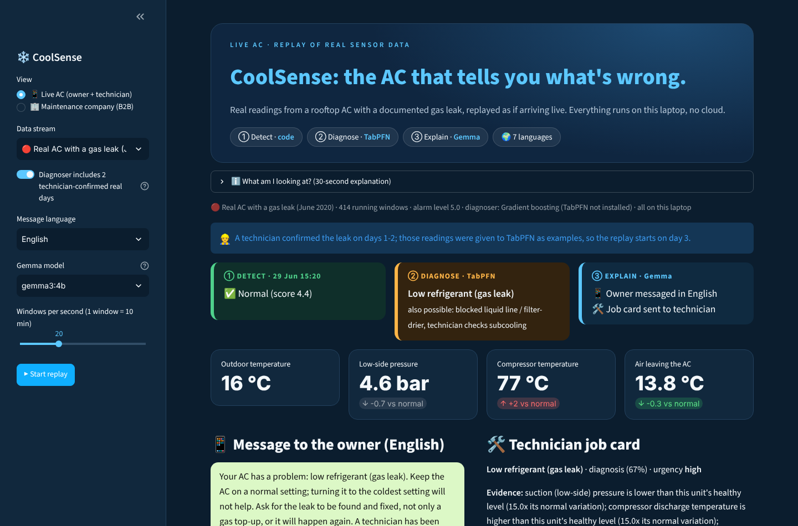
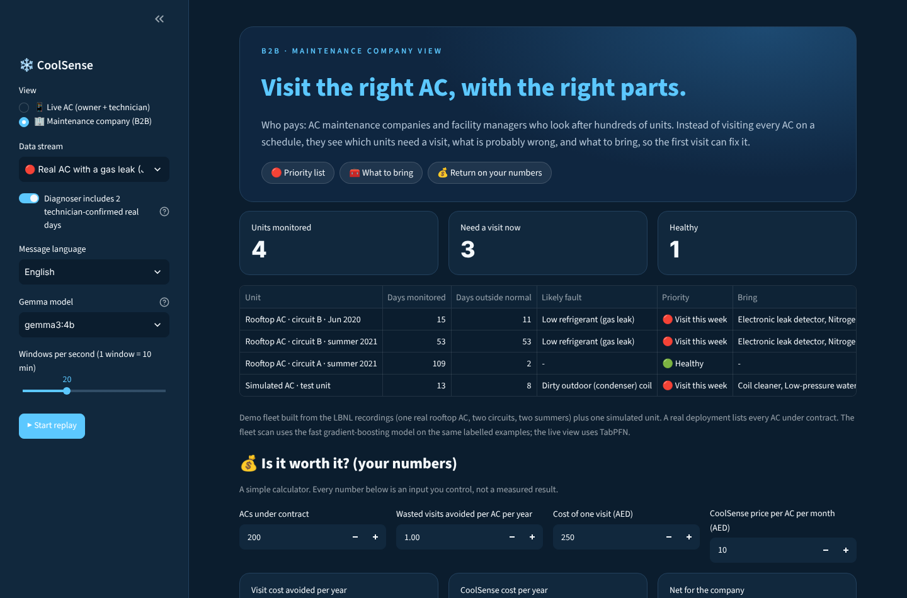

# ❄️ CoolSense: the AC that tells you what's wrong

**Code detects → TabPFN diagnoses → Gemma explains.** All open models, all on one laptop, no cloud.

When an AC fails, a technician usually visits once to find the fault and again with the parts.
CoolSense watches the unit's own sensor readings, names the likely fault, writes the owner a plain
message in their language, and gives the technician a job card with **what to bring**, so the first
visit can fix it.

**Who pays:** AC maintenance companies and facility managers (per AC, per month). They get a
priority list of which units need a visit, what's probably wrong, and what to put in the van.



Built for the [DEV Hacktoberfest Open-Source AI Challenge, Week 2: Side Hustle](https://dev.to/challenges/hacktoberfest-week2-2026-10-12).

## Demo

| Live AC (owner + technician) | Maintenance company (B2B) |
|---|---|
|  |  |

The app **replays real recordings** from a rooftop AC with a documented 40% refrigerant leak, as if
they were arriving live. It is not connected to a live unit yet.

## How it works

1. **Detect:** for each unit, a gradient-boosting model learns what every sensor *should* read given
   the weather and load. Each reading becomes a z-score ("how far from this unit's normal"), so the
   next step doesn't depend on unit size or sensor brand.
2. **Diagnose (TabPFN):** classifies flagged readings from labelled examples given as context, with
   no training step. A technician's confirmation can be added as extra examples straight away.
3. **Explain (Gemma via Ollama):** `gemma3:4b` writes the owner's message in Arabic, Hindi, Tamil,
   Malayalam, Urdu, Tagalog or English (JSON schema, script check and retry, English template fallback).
   **Gemma never chooses the fault or the numbers.** The technician's job card comes from a fixed
   knowledge base in code.

## Results on the real AC (LBNL field unit, Colchester, CT)

| Circuit / period | Days flagged |
|---|---|
| B, June 2020, documented leak (replayed days) | **11 / 15** |
| A, summer 2021, healthy | **2 / 109** |
| B, summer 2021, *labelled unfaulted* | **53 / 53** (see below) |

- **Simulation alone isn't enough.** Trained only on simulated faults, both TabPFN and gradient
  boosting called the real leak a *blocked liquid line* (the readings look alike). After adding
  **2 technician-confirmed days** (31 rows) to TabPFN's context, it named **98%** of the flagged
  readings in the replay *low refrigerant*. In the smaller benchmark run (100 examples per fault),
  that was 69% for TabPFN vs 53% for gradient boosting.
- **Circuit B in 2021** is labelled unfaulted, but its suction pressure is about 4.2 bar vs 5.4 bar
  after the 2020 fix, and its discharge temperature is about 93 °C vs 76 °C: the same direction as the
  leak, about half as far. It looks like the leak came back. This is a **hypothesis**; there are no
  service records to confirm it.
- **Simulated unit, unseen weeks:** 2% false alarms; diagnosis macro-F1 0.53 for gradient boosting
  vs 0.31 for hand-written rules. TabPFN was on par, not clearly better (0.55), and took 237 s vs 2 s on CPU.

Full tables, including the alarm-level sweep, are in [`results/rtu_metrics.md`](results/rtu_metrics.md).

## Run it

1. Download the **LBNL FDD Data Sets, RTU** (CC BY 4.0, DOI
   [10.25984/1881324](https://doi.org/10.25984/1881324)) and unzip it into `lbnl/`, so that
   `lbnl/Simulated RTU/RTU_sim_baseline.csv` and `lbnl/Field RTU/Site2_Unfaulted.csv` exist.
2. Install [Ollama](https://ollama.com) and pull the model: `ollama pull gemma3:4b`
3. Then:

```bash
python -m venv .venv
.venv\Scripts\activate          # Windows  (macOS/Linux: source .venv/bin/activate)
python -m pip install -r requirements.txt
python rtu_eval.py --no-tabpfn  # builds models/ (~1 min); drop --no-tabpfn to include TabPFN (slow on CPU)
python -m streamlit run app.py
```

| File | What it does |
|---|---|
| `rtu_data.py` | Loads LBNL simulated and field data into 10-minute windows while the compressor runs |
| `baseline.py` | Per-unit healthy model, z-scores, anomaly score, plain-language evidence |
| `rtu_eval.py` | All experiments; writes `results/rtu_metrics.md` and `models/` |
| `explain.py` | Gemma message plus knowledge-base job card |
| `app.py` | Streamlit demo: live replay plus the maintenance-company view |

## Limitations

- **A replay, not a live unit.** The next step is reading the same table from a building
  management system export (BACnet/Modbus) or clip-on pressure and temperature sensors.
- **The field alarm level (5) is a choice;** the healthy baseline is short. See the sweep in the results.
- **TabPFN is slow on CPU,** so it runs only on flagged windows. The B2B fleet scan uses the fast
  gradient-boosting model on the same examples.
- **Licensing:** newer TabPFN weights are under a non-commercial licence. A paid product needs
  Prior Labs' commercial terms or the gradient-boosting fallback. Gemma's terms allow commercial use.

## License

Code: MIT (see `LICENSE`). Data: LBNL FDD Data Sets, CC BY 4.0, not included in this repo.
